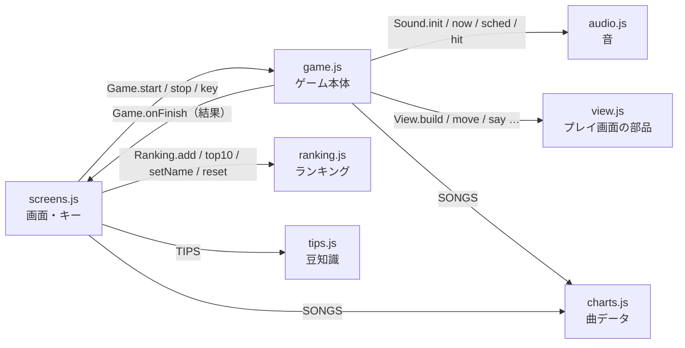
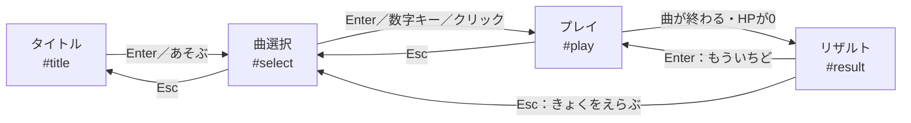
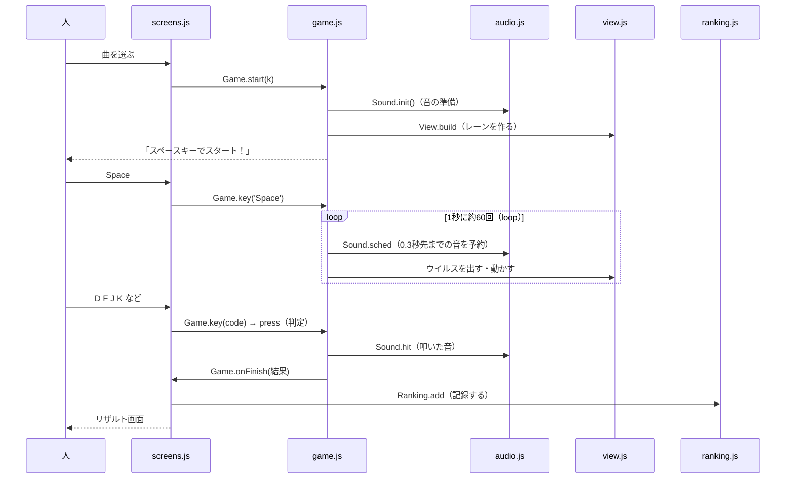

# ゆめかわ★ウイルス・ぽっぷ　プログラムの説明書

3班（松井・岡野・中山）で、プログラム全体のしくみを共有するための説明書です。
「どのファイルが何をしているか」「1回遊ぶと、どの順番で何が動くか」「音はどうやって鳴っているか」を、コードの名前と一緒に説明します。

- もとにしたもの：班のリポジトリの main（2026/10/23、#55 のあと）
- くわしい決まりは仕様書（`docs/terafes_03_05_仕様書.md`）。この説明書の中の「仕様書 5.3」などは、その章の番号です
- コードを読むときは、行の右にある `// ★` の説明もいっしょに見てください

---

## 1. ひとことで言うと

- **HTML・CSS・JavaScript だけ**で動く、ブラウザのゲームです。サーバーもネットも使いません。
- 画面は**1つのページの中に4つ重なっていて**、そのうち1つだけを見せています（タイトル → 曲選択 → プレイ → リザルト）。
- 音は**音のファイルを使わず**、JavaScript（Web Audio API）でその場で作っています。
- ゲームの時計は**音の時計**です。音とウイルスの動きがずれないように、同じ時計を使っています。

---

## 2. ファイルの一覧と担当

| ファイル | 中身 | 担当 |
|---|---|---|
| `index.html` | 4つの画面の入れ物。JavaScript を決まった順番で読み込む | 松井 |
| `chara.css` | キャラ（ウイルス3体）の見た目。全画面で共通 | 松井 |
| `style.css` | 全体・タイトル・曲選択・プレイ画面の見た目、フォント | 松井 |
| `result.css` | リザルト画面（認定証・ランキング）の見た目 | 岡野 |
| `charts.js` | 曲データ `SONGS`（6曲）と、全員が使う `$` | 中山 |
| `ranking.js` | ランキングの保存・読み込み `Ranking` | 松井 |
| `tips.js` | セキュリティ豆知識の文 `TIPS` | 岡野 |
| `audio.js` | 音（ドラム・ベース・和音・薄いメロディ・叩いた音） `Sound` | 中山 |
| `view.js` | プレイ画面の部品（レーン・ウイルス・スコア表示・演出） `View` | 中山 |
| `game.js` | ゲーム本体（譜面づくり・ウイルスの動き・判定・スコア・HP） `Game` | 中山 |
| `screens.js` | 画面の切り替え、キー入力の振り分け、曲カード、本日のトップ3、リザルト画面 `Screens` | 松井 |
| `fonts/` | 丸ゴシックのフォント（M PLUS Rounded 1c）とライセンス | 松井 |
| `images/title.png` | タイトル画面の絵 | 松井 |

---

## 3. ファイルどうしのつながり

### 読み込む順番（index.html のいちばん下）

```
charts.js → ranking.js → tips.js → audio.js → view.js → game.js → screens.js
```

- **charts.js がいちばん先**なので、そこで作った `$` と `SONGS` は、あとのファイル全部で使えます。
- **screens.js がいちばん最後**です。ほかの部品が全部そろってから、画面を動かし始めます。

### だれが、だれを呼ぶか



- **松井さんの screens.js と、中山の game.js は、決まった「つなぎ目」だけで話します**（仕様書 10.1・10.2）。
  - screens.js → game.js：`Game.start(k)`（k番目の曲で始める）、`Game.stop()`（やめる）、`Game.key(code)`（押されたキーを渡す）
  - game.js → screens.js：ゲームが終わったら `Game.onFinish(result)` で結果を渡す
- つなぎ目を決めておいたので、ほかの人の画面ができていなくても、自分の担当を先に作って確かめられました。

### 「中が見えない入れ物」の形

`Game`・`Sound`・`Ranking`・`Screens` は、どれも同じ書き方をしています。

```js
const Game = (() => {
  let S = null;          // 中だけで使う変数（外からは見えない）
  function press(l) { … }  // 中だけで使う関数
  return {               // ここに書いたものだけが、外から使える
    start(k) { … },
    key(code) { … },
  };
})();
```

- `( ) => { … }` という関数を作って、すぐ `()` で実行しています。
- 中で作った変数（ゲームの状態 `S` など）は、外のファイルから勝手に書きかえられません。**外から使えるのは `return { … }` に書いたものだけ**です。
- `View` だけは、ふつうのオブジェクト `{ … }` にまとめています（中に隠すものがないため）。

---

## 4. 画面の流れとキー



- 画面の切り替えは `Screens.show(name)` です。4つの画面のうち、`name` の画面にだけ `class="on"` を付けます（screens.js）。
- **キーは全部 screens.js が受け取って**、いまの画面に合わせて振り分けます（仕様書 4章）。
  - プレイ中は、Esc 以外のキーを全部 `Game.key(code)` に渡します。レーンのキーかどうかは game.js が決めます。
- 画面の大きさは、いつも 1067×600 の「舞台」（`#stage`）を、ウィンドウに合わせて拡大・縮小しています（screens.js の `fit()`）。

---

## 5. 1回遊ぶと、どの順番で何が動くか



1. **準備（`Game.start(k)`）**：曲データから譜面（ウイルスの一覧）を作り、ゲームの状態 `S` を新しく作ります。HP は 10、スコアは 0。前のプレイのループが残っていたら止めます。
2. **スタート待ち**：Space が押されるまで、ループは始まりません（自分のタイミングでスタート）。
3. **Space**：曲の開始時刻 `S.t0` を「いまから0.3秒後」に決めて、ループを始めます。
4. **ループ（`loop()`）**：ブラウザが画面を書きかえるたびに（1秒に約60回）呼ばれます。
   - 0.3秒先までの音を予約する（`Sound.sched`）
   - そろそろ見えるウイルスを出す
   - ウイルスを下へ動かす。判定ラインを0.2秒過ぎたウイルスはミス（HP −1）
   - のこり時間とバーを書きかえる
   - HP が 0 か、曲が終わったら `finish()`
5. **キーを押す（`press(l)`）**：そのレーンで、いちばん近いウイルスを探して判定します。
6. **終わり（`finish()`）**：防衛率とランクを計算して、`Game.onFinish(result)` で screens.js に渡します。
7. **リザルト（`showResult(r)`）**：認定証を出し、ランキングに記録し、豆知識を1つ出します。10位以内なら名前を入力できます。

---

## 6. 曲データ（charts.js）の読み方

### 6曲の設定

| 番号 | 曲 | 星 | ラベル | レーン | BPM | 落ちる時間 |
|---|---|---|---|---|---|---|
| 0 | きらきら星 | 1 | らくちん | 2（F J） | 100 | 2.2秒 |
| 5 | よろこびのうた | 2 | かんたん | 4（D F J K） | 100 | 1.8秒 |
| 1 | ジングルベル | 3 | ふつう | 4 | 120 | 1.6秒 |
| 3 | ねこふんじゃった | 4 | ちょいむず | 4 | 90 | 1.5秒 |
| 4 | エンターテイナー | 5 | むずい | 4 | 76 | 1.5秒 |
| 2 | 天国と地獄 | 6 | げきむず | 4 | 120 | 1.4秒 |

- 曲選択画面とトップ3は**星の少ない順**に並びます（screens.js の `ORDER`）。だから、SONGS の中の順番を変えなくても、難しさの順に並びます。
- **SONGS の並びは変えない**でください。ランキングの保存場所が曲の番号（0〜5）で決まっているからです。曲を増やすときは、いちばん後ろに足します。

### 譜面 `chart` の書き方

スペースで区切った「音名:拍の数」の並びです。

| 書き方 | 意味 | 例 |
|---|---|---|
| `C4` | 音名（ドレミ＝C D E F G A B）＋オクターブ。C4＝真ん中のド | `G4` ＝ ソ |
| `:2` `:.5` | 長さ（拍）。書かなければ1拍 | `G4:2` ＝ ソを2拍 |
| `#` | 半音上 | `F#5` |
| `R` | 休み（ウイルスは出ない） | `R:2` |
| `+` | 同時に落ちる（ウイルス2匹以上）。先に書いた音がメロディ | `G4+C4:2` |
| `=` | 左＝落ちてくる位置の音、右＝叩いたときに鳴る音（ウイルスは1匹） | `F#5=A#3+F#4`（1匹で和音） |
| `&` | `&` で区切った1つずつが同時に落ちる1匹。それぞれに `=` が使える | `B5=B4+D5+G5&G3=G2+G3` |

### 伴奏 `chords` の書き方

- 「コード名:拍の数」の並びです。拍の合計は、`chart` の拍の合計と同じにします。
- コード名：`C`＝ドミソ、`F`＝ファラド、`G`＝ソシレ、`Am`＝ラドミ（`m`＝短調）、`G7`＝ソシレファ（`7`＝セブンス）、`R`＝伴奏なし。
- `chords` を書かない曲は、C → Am → F → G をくり返します。

---

## 7. 譜面ができるまで（game.js の `chart`）

曲データの文字列を、「いつ・どのレーンに落ちるか」の一覧（ノーツ）にします（仕様書 5.2）。

1. **1拍の長さ** ＝ 60 ÷ BPM 秒（BPM100 なら 0.6秒）。
2. **準備時間** ＝（落ちる時間 ＋ 0.3秒）を1拍単位で切り上げたもの。
   例：きらきら星は 2.2＋0.3＝2.5秒 → 5拍 → 3.0秒。最初のウイルスが落ちてくる間に、リズムが始まります。
3. **レーンの決め方**：曲に出てくる音を低い順に並べて、レーンの数で分けます。
   - 式：レーン ＝ 切り捨て（低い方から何番目 × レーン数 ÷ 音の種類の数）
   - 例：きらきら星の音は ド・レ・ミ・ファ・ソ・ラ の6つ。2レーンなので、ド・レ・ミ → 左（F）、ファ・ソ・ラ → 右（J）。
   - **低い音は左、高い音は右**になるので、ピアノと同じ感覚で叩けます。
   - 同じ拍で同じレーンになったら、右へ1つずらします（右がなければ左へ）。
4. **到達時刻** ＝ 準備時間 ＋ それまでの拍 × 1拍の長さ。
5. **キャラの種類** ＝ レーン番号を3で割った余り（0：ランサム、1：フィッシング、2：DDoS）。
6. **鳴る音の高さ（Hz）** ＝ 440 × 2 の（音の番号 − 69）÷ 12 乗。ラ（69番）＝440Hz で、12 上がる（1オクターブ上がる）と2倍になります。

---

## 8. 時計・判定・スコア（game.js）

### 時計

- `Sound.now()`（Web Audio の時計）を、ゲーム全体の時計にしています。
- 「曲が始まってから何秒か」＝ `Sound.now() - S.t0`。ウイルスの位置も判定も、全部この秒数で計算します。
- 音と同じ時計なので、パソコンが少し重くなっても、音とウイルスがずれません。

### ウイルスの動き

- **出てくる**：到達時刻まで「落ちる時間 × 1.15」を切ったら出す。
- **位置**：縦の位置 ＝ 500 −（到達時刻 − いま）÷ 落ちる時間 × 530。判定ラインは y＝500。
- **動かし方**：`transform: translate(x, y)` で動かすので軽い（view.js の `View.move`）。

### 判定とスコア（仕様書 5.3・5.5）

| ずれ | 判定 | 基本点 |
|---|---|---|
| 0.06秒未満 | 大優勝！ | 300 |
| 0.12秒未満 | 神！ | 200 |
| 0.2秒以内 | 超かわよ！ | 100 |
| 0.2秒を過ぎても叩かない | ざんねん…（ミス） | 0（HP −1） |

- スコア ＝ 基本点 ＋ コンボ（最大50まで）× 2。
- ミスすると、HP −1、コンボ 0、画面が0.25秒揺れます。
- 何もない所を叩いても、ペナルティはありません（リングが光るだけ）。

### 終わりとランク（仕様書 5.6・5.7）

- 終わるのは、**HP が 0 になったとき**か、**準備時間＋曲の長さ＋1秒を過ぎたとき**。
- 防衛率 ＝ 撃退した数 ÷ 全部のウイルスの数 × 100（四捨五入）。途中で HP が 0 になっても、分母は全部の数。
- ランク：95%以上 S（超大優勝★）、85%以上 A（大優勝！）、70%以上 B（神！）、それ以外 C（まだまだかわいい）。

---

## 9. 音のしくみ（audio.js）

音は全部、Web Audio API でその場で作っています。音のファイルは1つもありません。

### 部品のつなぎ方

Web Audio は、部品をつないで音を作ります。電子ピアノの中身を、プログラムで組み立てるイメージです。

```
発振器（決まった高さの音を出す） → 音量（だんだん小さく） → スピーカー
```

| 関数 | 作る音 | しくみ |
|---|---|---|
| `tone(f, at, d, type, v)` | ポーンと鳴って消える音（メロディ・ベース・和音・叩いた音） | 高さ f(Hz) の音を、時刻 at に音量 v で鳴らし、d 秒でほぼ0まで小さくする |
| `kick(at)` | ドラムの「ドン」 | 150Hz から 40Hz まで、0.15秒ですばやく下げる |
| `hiss(at, d, v, hp)` | ハイハット「チッ」、クラップ「パン」 | でたらめな数で作った雑音（ザーッ）から、低い音を取りのぞく。7000Hz より下を取ると「チッ」、1500Hz より下を取ると「パン」 |

- 音色は `sine`（やわらかい）と `triangle`（少しはっきり）の2つを使い分けています。
- 音量はファイルの上の `VOL` にまとめてあります（薄いメロディ 0.07、叩いた音 0.3、ベース 0.22、和音1音 0.05）。

### 音は「予約」して鳴らす

- Web Audio は「◯秒の時刻に鳴らす」と**先に予約**できます。
- `Sound.sched(S)` はループのたびに呼ばれて、**いまから0.3秒先までの音**をまとめて予約します。
- 1回ずつ「いま鳴らす」よりも、タイミングがずれません。
- ブラウザの決まりで、キーやクリックのあとでないと音が出せません。だから、最初に曲を始めるとき（`Game.start` の中の `Sound.init()`）に音の準備をします。

### リズムの決まり（1小節を16個に分ける）

1拍を4つに分けた「16分音符」を1つの単位にして、1小節（4拍）＝16個で数えます。

| 16個の中の番号 | 0 | 2 | 4 | 6 | 8 | 10 | 12 | 14 |
|---|---|---|---|---|---|---|---|---|
| キック「ドン」 | ● | | ● | | ● | | ● | |
| ハイハット「チッ」 | | ● | | ● | | ● | | ● |
| クラップ「パン」 | | | ● | | | | ● | |
| ベース「ボン」 | ● | | | ● | ● | | | ● |
| 和音「ジャッ」 | | | ● | | | | ● | |

- ベースの高さは、そのときのコードの根音（C なら ド）です。
- 和音は、コードの音（ドミソなど）を全部同時に鳴らします。
- **小節の頭は、メロディの始まりにそろえています**。準備時間のうち1小節に足りない分は鳴らさないので、リズムは必ず1拍目の「ドン」から始まります。ベースと和音は、メロディと一緒に入ります。
- **曲の最後のコードの間は、ドラムだけ**になります（ベースと和音は鳴らさない）。

### コードから和音を作る（`parseChords`）

- 根音の番号（ド＝0、レ＝2 … シ＝11）を決めます。
- 和音 ＝ 根音・3度・5度（ドミソの形）。
  - 3度：ふつうは根音の4半音上、`m`（短調）なら3半音上
  - 5度：根音の7半音上
  - `7` のコードは、10半音上の音も足す（G7 ならファ）
- どのコードも同じくらいの高さになるように、和音はソ〜ファ#、ベースはファ〜ミの間に置いています。

### 薄いメロディと、叩いた音

- **薄いメロディ**：ウイルスが判定ラインに着く時刻に、小さい音（0.07）でメロディを鳴らします。叩かなくても、曲の流れが聞こえます。`+` の2つ目より後の音は鳴らしません。
- **叩いた音（`Sound.hit`）**：撃退したとき、そのウイルスの音を大きく（0.3）鳴らします。和音のときは、音の数が多くても大きくなりすぎないように、1つずつの音量を「0.3 ÷ √音の数」にしています（2音なら約0.7倍、4音なら半分）。

---

## 10. プレイ画面の部品（view.js）

`View` は**画面に出す・書きかえるだけ**を受け持ちます。点数やミスの計算は game.js がします。

| 関数 | すること |
|---|---|
| `View.build(song)` | レーン・判定ライン・判定リング・キー札を作る。前のプレイの表示を消す |
| `View.mkVirus(ty, santa)` | ウイルスを1体作る（ジングルベルのときはフィッシングがサンタ） |
| `View.move(el, x, y)` | ウイルスを動かす |
| `View.lx(n, l)` | レーン l の真ん中の x（レーンは画面の真ん中にそろえる。1本 110px） |
| `View.setHud(S)` | スコア・コンボ・ハート（いつも10個、減った分は薄い色） |
| `View.setTime(left, rate)` | のこり時間と進行バー |
| `View.ready(tx)` | 「スペースキーでスタート！」「じゅんびしてね…」 |
| `View.say(tx, c)` | 判定の文字（大優勝！など）を出す |
| `View.flash(l)` | キーを押したリングを0.1秒光らせる |
| `View.burst(x)` | 撃退したとき、色付きの粒12個を飛ばす |
| `View.shake(r)` | ミスしたとき、画面を揺らす |
| `View.clear()` | ウイルスと粒を全部消す |

- 数字や色（舞台の幅 1067、判定ラインの高さ 500、レーンの幅 110、レーンの色4つ）は、`View` の中にまとめています。screens.js に `W` という名前があるので、名前がぶつからないようにするためです。

---

## 11. ランキングと豆知識

### ranking.js（`Ranking`）

- 曲ごとに、**上位10件**をブラウザの LocalStorage に保存します（保存の名前は `yumekawa_hs_0` 〜 `yumekawa_hs_5`）。
- 記録の形：`{ s: スコア, r: 防衛率, at: 登録した時刻, n: 名前 }`。
- 名前は6文字まで。前後の空白は取り、空なら「ななし」。画面に出すときは `textContent` を使うので、名前に HTML を入れられても、HTML として動きません（安全のため）。
- LocalStorage が使えないときも止まらないように、読み書きを `try { } catch { }` で囲んでいます。保存できなくても、ページを開いている間はメモリに記録が残ります。
- 保存する前に最新の記録を読み直すので、ほかのタブで保存した記録を消してしまうことがありません。
- スタッフ用の「ランキングをリセット」は、パスワードと確認のあとで全部の記録を消します（パスワードは screens.js の `RESET_PASS`）。

### 本日のトップ3（screens.js の `renderToday`）

- タイトル画面を出すたびに、曲ごとの上位10件から**今日の日付の記録だけ**を取り出して並べます。
- 6曲あるので、いちばんやさしい2曲は1列にまとめて、それぞれ1位だけを出します。

### tips.js（`TIPS`）

- リザルト画面に、ランダムで1つ出します。文は IPA（情報処理推進機構）のページをもとに作っています（ページの URL は tips.js の先頭）。

---

## 12. 「ここを直したいときは、どこ？」

| 直したいこと | ファイルと場所 |
|---|---|
| 曲を足す・譜面を直す | `charts.js` の `SONGS`（いちばん後ろに足す） |
| 曲の速さ・難しさ | `charts.js` の `bpm`（テンポ）、`fall`（落ちる時間）、`lanes` |
| 判定の厳しさ・点数 | `game.js` の `JUDGE`、`MISS` |
| ランクの境目 | `game.js` の `finish()` |
| HP の数 | `game.js` の `start()` の `hp: 10` |
| 音の大きさ | `audio.js` の `VOL` |
| リズムの形（ドン・チッ・パン） | `audio.js` の `sched()` の中の番号 |
| レーンの色・幅 | `view.js` の `COLORS`、`LANE_W` |
| 画面の切り替え・キーの意味 | `screens.js` の `keydown` のところ |
| 曲カードの見た目 | `screens.js` の `buildCards()`、`style.css` |
| リザルト画面の見た目 | `result.css` |
| キャラの見た目 | `chara.css` |
| 豆知識の文 | `tips.js` の `TIPS` |

> 自分の担当でないファイルを直したいときは、先に担当の人に相談してから（仕様書のルール）。

---

## 13. ことばのミニ辞典

| ことば | 意味 |
|---|---|
| ノーツ | 落ちてくるウイルス1匹ぶんのデータ（いつ・どのレーン・どの音） |
| レーン | ウイルスが落ちてくる縦の通り道（2本か4本） |
| 判定ライン・判定リング | ウイルスが重なった瞬間にキーを叩く場所（y＝500） |
| BPM | 1分間に何拍か。100 なら1拍0.6秒 |
| 拍 | 曲のリズムの1つ分。4拍で1小節 |
| 16分音符 | 1拍を4つに分けた長さ。リズムの予約はこの単位 |
| Hz（ヘルツ） | 音の高さ。数が大きいほど高い音（ラ＝440Hz） |
| MIDI番号 | 音の高さの番号。真ん中のド＝60、ラ＝69。1つ上がると半音上 |
| 根音 | コードのいちばん元になる音（C なら ド） |
| Web Audio API | ブラウザで音を作ったり鳴らしたりするしくみ |
| requestAnimationFrame | 「次に画面を書きかえるときに、この関数を呼んで」とブラウザに頼む命令（1秒に約60回） |
| LocalStorage | ブラウザの中に、文字のデータを保存しておける場所 |
| HUD | プレイ中に画面に出しているスコア・HP・のこり時間など |
